# SoftKiteReference

**A simple, fast, open reference model of a soft-wing (leading-edge inflatable) pumping
kite power system in Python, parameterised for the TU Delft V3 kite.**

It simulates the whole system in closed loop: kite, tether, winch and a pilot that flies
complete pumping cycles. The cycles are figures of eight while reeling out, then
depower, reel in and repeat. The only dependencies are `numpy`, `scipy`, `matplotlib`
and `pyyaml`. A 100 s pumping cycle simulates in about 5 s.

<p align="center">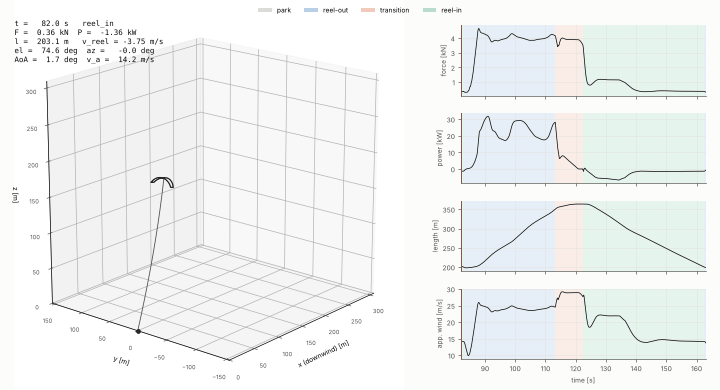</p>

---

## Contents

1. [At a glance](#1-at-a-glance)
2. [Installation](#2-installation)
3. [Quick start](#3-quick-start)
4. [What a reference model is](#4-what-a-reference-model-is)
5. [Classification of this model](#5-classification-of-this-model)
6. [The system being modelled](#6-the-system-being-modelled)
7. [Frames, angles and sign conventions](#7-frames-angles-and-sign-conventions)
8. [Architecture: the building blocks](#8-architecture-the-building-blocks)
9. [Block A: wind](#9-block-a-wind)
10. [Block B: quasi-steady tether](#10-block-b-quasi-steady-tether)
11. [Block C: aerodynamics and pitch trim](#11-block-c-aerodynamics-and-pitch-trim)
12. [Block D: kite motion and steering](#12-block-d-kite-motion-and-steering)
13. [Block E: KCU actuators and winch](#13-block-e-kcu-actuators-and-winch)
14. [Block F: controllers (the pilot)](#14-block-f-controllers-the-pilot)
15. [Simulation loop and numerics](#15-simulation-loop-and-numerics)
16. [Reading the results](#16-reading-the-results)
17. [Verification and validation](#17-verification-and-validation)
18. [Is it good enough? Scope of use](#18-is-it-good-enough-scope-of-use)
19. [Assumptions and limitations](#19-assumptions-and-limitations)
20. [Configuration reference](#20-configuration-reference)
21. [Outputs: the log and cycle statistics](#21-outputs-the-log-and-cycle-statistics)
22. [Python API](#22-python-api)
23. [Examples](#23-examples)
24. [Re-identifying the aerodynamics](#24-re-identifying-the-aerodynamics)
25. [Repository layout](#25-repository-layout)
26. [Provenance of every number](#26-provenance-of-every-number)
27. [Changelog](#27-changelog)
28. [Roadmap](#28-roadmap)
29. [Glossary](#29-glossary)
30. [References](#30-references)
31. [Credits and licence](#31-credits-and-licence)

---

## 1. At a glance

| Question | Answer |
|---|---|
| What is it? | A dynamic point-mass (3-DOF) model of the TU Delft V3 soft kite, with a quasi-steady tether, pitch trim from aerodynamic moment tables, an identified turn-rate law, a winch, and a full pumping-cycle controller. |
| Does it run? | Yes. Stable, repeatable pumping cycles from 5 to 12.5 m/s wind. 19 automated tests pass. |
| Is the physics consistent? | Yes. Reel-out speed, apparent wind and power agree with quasi-steady theory to within 3 %, and constant-length eights agree with Loyd's formula to within 2–4 %. The tether solver reproduces the reference results of the original MATLAB implementation to 9 digits. |
| Does it match flight data? | The pulling force does. The rigid-wing aerodynamics are too efficient (L/D 6.1 vs about 3.6 in flight), so reel-out power is about 2x too high out of the box. One calibrated drag number (`cd_extra = 0.067`) brings energy per cycle within 1 % of the 7 May 2013 flight. See [section 17](#17-verification-and-validation). |
| What is it good for? | Pumping-cycle and controller studies, operating-strategy comparisons, system-level and scaling trends (with calibrated drag), teaching, and fast prototyping before V3Kite.jl. |
| What is it not for? | Structural loads, canopy deformation, pitch and roll oscillations, gust response, and absolute power with the uncalibrated default. |

**Default result** (V3, 9.51 m/s at 6 m height, tether 200–350 m): mean mechanical
cycle power **6.9 kW**, cycle time **80 s**. Reel-out lasts 30 s at 23 kW, 4 kN and
5.7 m/s. Reel-in lasts 40 s.

---

## 2. Installation

Python 3.9 or newer.

```bash
cd SoftKiteReference
pip install -e .[fast]        # numpy, scipy, matplotlib, pyyaml + numba (optional, ~2x faster)
python -m pytest              # 19 tests, about 15 s
```

Alternatives:

```bash
pip install -r requirements.txt          # same packages without installing softkite itself
pip install -e .                         # without numba: everything works, about half the speed
pip install -e .[fast,fit,vsm,test]      # + pandas (V3Kite fit), VSM (aero identification), pytest
```

Saving an MP4 replay needs `ffmpeg` on the PATH. GIF export works without it.

---

## 3. Quick start

From the repository root (on Windows use `\` in paths):

```bash
python examples_simple/05_pumping_cycle.py            # 300 s of pumping: table, plots, log in output/
python examples_simple/06_replay.py                   # 3-D replay of that log in a window
python examples_simple/06_replay.py --save output/pumping.mp4
python examples_simple/09_validate_flight_2013.py     # comparison with the 2013 test flight
```

From Python:

```python
from softkite import Simulation, load_settings, cycle_stats
from softkite.viewer import plot_timeseries, replay

s = load_settings(environment__v_wind_ref=8.0, kite__cd_extra=0.067)   # section__key overrides
log = Simulation(s).run(300)          # default controller: full pumping cycle
for c in cycle_stats(log):
    print(c["cycle"], c["mean_power"], c["duration"])
plot_timeseries(log, show=True)
anim = replay(log)                    # keep a reference to the animation
```

---

## 4. What a reference model is

A **reference model** is a fully specified, openly published model of one
representative machine. Everyone can run it, compare against it and build on it. The
model is half of it. The other half is the shared agreement that *this* is the baseline.

The idea comes from conventional wind energy. The NREL 5 MW and IEA 15 MW reference
turbines were never built. They exist as complete public descriptions (geometry,
airfoils, masses, controller, simulation inputs), and hundreds of studies use them, so
a new blade or controller can be compared with someone else's on equal terms.

In airborne wind energy, **MegAWES** is an open reference model of a multi-megawatt
rigid-wing pumping system (MATLAB/Simulink, 3-DOF or 6-DOF kite, segmented tether,
aero lookup tables, flight controller, winch). **IEA Wind Task 48** lists reference
models for the field, including the TU Delft V3 kite, and notes that the term itself
still needs defining. There is no open, easy-to-install dynamic model of a **soft**
wing with a complete pumping controller. That is the gap this package fills.

### What a reference model must provide, and how this one does it

| Requirement | Here |
|---|---|
| A defined system with documented parameters | TU Delft V3 kite on a 4 mm Dyneema tether. Every default is in `softkite/data/settings.yaml` with its source ([section 26](#26-provenance-of-every-number)). |
| Open, quick to install and run | Four standard Python packages; about 20x faster than real time. |
| Documented assumptions | This README, sections 8–15 and 19. |
| A baseline controller | Full pumping cycle: entry, figure-eight reel-out, transition, reel-in. |
| Verification (the code solves its equations correctly) | 19 tests, a MATLAB reference case, the catenary limit, and quasi-steady theory ([section 17](#17-verification-and-validation)). |
| Validation (the equations describe the real kite) | The 7 May 2013 flight and V3Kite.jl ([section 17](#17-verification-and-validation)). Partly met: drag needs calibration. |

> In control theory, "reference model" also means the ideal response an adaptive
> controller tracks (model-reference adaptive control). That meaning is unrelated.

---

## 5. Classification of this model

Kite models form a fidelity ladder. Each rung adds physics and cost:

| Rung | Model class | What it resolves | Examples |
|---|---|---|---|
| 0 | Analytic | ideal crosswind power in one formula | Loyd (1980) |
| 1 | Quasi-steady (QSM) | force balance per instant, phase averages, no time dynamics | Schmehl / van der Vlugt QSM, AWESPA |
| **2** | **Dynamic point mass (3-DOF)** | **flight path over time; kite = mass with forces** | **this model**, KPS3, MegAWES 3-DOF |
| 3 | Rigid body (6-DOF) | adds roll, pitch, yaw dynamics | MegAWES 6-DOF |
| 4 | Multi-body / particle system | kite as several connected masses | KPS4 |
| 5 | Aero-structural | deforming wing and bridle, vortex-step aerodynamics | V3Kite.jl, kite_fem |
| 6 | CFD / FSI | resolved flow around the canopy | RANS, coupled solvers |

Spelled out, this model is:

- **Dynamic and time-domain.** It integrates the equations of motion in 10 ms steps, so
  it shows transients, not just averages.
- **A 3-DOF point mass.** Wing and KCU are one 19 kg mass. The three degrees of freedom
  are its x, y and z position. Attitude is not a dynamic state.
- **Grey-box (semi-empirical).** Newton's law, tether mechanics and vortex-step
  aerodynamics are physics. The turn-rate law is identified from a higher-fidelity
  model (V3Kite.jl).
- **Built on quasi-steady sub-models.** The tether shape and the wing pitch are solved as
  instantaneous equilibria, not integrated in time. Both settle much faster than the
  flight path changes.
- **Lumped-parameter.** Ten tether nodes and one kite mass, no continuous fields.
- **Closed-loop.** It always flies with its controller.
- **Deterministic.** Steady wind with a shear profile and no turbulence, so the same
  inputs always give the same output.

**Why this rung?** It is the lowest rung that shows the time behaviour of the
flight path and the controllers. Rung 1 cannot. It is also orders of magnitude cheaper
than rungs 3–5, which need parameters that are often unknown for soft kites (inertias,
damping, structural stiffness).

---

## 6. The system being modelled

### How a pumping kite power system works

1. **Reel-out (traction).** The kite flies fast crosswind figures of eight and pulls
   hard (here about 4 kN). The tether unwinds from a drum that drives a generator:
   mechanical power = tether force × reel-out speed.
2. **Transition.** The kite is partly depowered and steered up out of the pattern.
3. **Reel-in (retraction).** The kite is depowered (low angle of attack, weak pull) and
   the motor winds the tether back in. This costs much less energy than reel-out made.
4. Repeat. Net energy = reel-out energy − reel-in energy.

### The TU Delft V3 kite

| Item | Value | Source |
|---|---|---|
| Wing area, flat / projected | 25 m² / 19.41 m² | V3 CAD geometry (VSM) |
| Span / reference chord (mid-span) | 8.27 m / 2.60 m | V3 CAD geometry (VSM) |
| Wing mass incl. bridle | 10.6 kg | V3 reported value (V3Kite.jl uses 11.0) |
| KCU mass | 8.4 kg | V3Kite.jl |
| Total airborne mass | 19.0 kg | sum |
| KCU drag area | 0.059 m² (C_D 0.47, Ø 0.4 m) | KiteUtils defaults |
| Bridle point (KCU) below the wing | about 11 m | VSM geometry |
| Tether | Dyneema, Ø 4 mm, 724 kg/m³, EA = 614.6 kN, C_D 0.958 | Tethers.jl defaults |
| Tether mass | 9.1 g/m (3.2 kg at 350 m) | computed |
| Force limit (nominal) | 4 kN | V3 nominal |
| Reel speed limits | ±8 m/s | KiteUtils V3 settings |

The **KCU (kite control unit)** hangs where the bridle lines meet the tether. It holds
two motors:

- a **steering** motor that pulls the left or right steering line (relative input
  `u_s`, limited to ±0.32);
- a **depower** motor that lengthens the rear lines to lower the wing's angle of attack
  (relative input `u_p`: 0.22 = fully powered, 0.40 = depowered).

---

## 7. Frames, angles and sign conventions

<p align="center">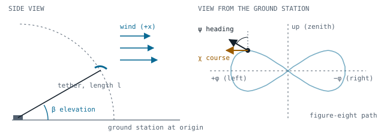</p>

| Symbol | Name | Definition | Sign / range |
|---|---|---|---|
| W frame | wind frame | origin at the ground station; x downwind, z up, y to the left (seen from the ground station looking downwind) | right-handed |
| β | elevation | angle of the kite position above the horizontal | 0° horizon, 90° zenith |
| φ | azimuth | sideways angle of the kite position from the downwind direction | positive to the **left** |
| ψ | heading | direction of the kite's nose in the plane tangent to the sphere, measured from "up" | 0 = nose to zenith, positive = nose to the **right** |
| χ | course | direction of the kite's velocity in the same plane, measured like ψ | same as ψ |
| α | angle of attack | angle between the apparent wind and the wing chord | degrees, positive nose up |
| u_s | steering | relative steering input | positive turns right (ψ increases) |
| u_p | depower | relative depower input | larger = less power |

Unit vectors at the kite position:

```math
\hat e_r = (\cos\beta\cos\phi,\ \cos\beta\sin\phi,\ \sin\beta),\quad
\hat e_{up} = (-\sin\beta\cos\phi,\ -\sin\beta\sin\phi,\ \cos\beta),\quad
\hat e_{right} = (\sin\phi,\ -\cos\phi,\ 0)
```

Kite axes: nose $\hat x_k = \cos\psi\,\hat e_{up} + \sin\psi\,\hat e_{right}$ and span
$\hat y_k = \hat e_r \times \hat x_k$.

Heading and course differ by a few degrees (about 13° RMS in reel-out). This is the
physical crab angle, caused by the wind component across the kite's path. Angles are
stored in **radians** in the code and logs, except α, which is in **degrees**.

---

## 8. Architecture: the building blocks

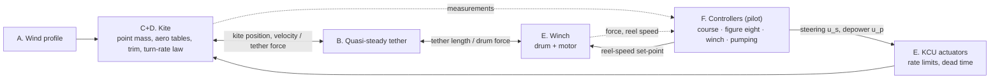

| Block | File | Julia counterpart in the original plan |
|---|---|---|
| A. Wind | `softkite/kite_model.py` (`wind_speed`) | AtmosphericModels.jl (profile law only) |
| B. Tether | `softkite/static_tether.py` | Tethers.jl `QuasiSteady` → "StaticTethers" |
| C. Aerodynamics | `softkite/aero.py` + `softkite/data/v3_aero.yaml` | CL, CD, CM identified from V3Kite.jl |
| D. Kite motion and steering | `softkite/kite_model.py` | rigid-wing model in KiteModels.jl |
| E. KCU and winch | `softkite/kite_model.py` | KitePodModels.jl / WinchModels.jl |
| F. Controllers | `softkite/controllers/` | SimpleKiteControllers.jl (now RobustKiteControllers.jl), plus full pumping |
| Viewer | `softkite/viewer.py` | KiteViewers.jl |
| Settings, logging | `softkite/settings.py`, `softkite/simulator.py` | KiteUtils.jl |

The model's **state** is ten numbers:

```
y = [ x, y, z,   v_x, v_y, v_z,   ψ,   l,   v_reel,   u_s,lagged ]
      kite position  kite velocity  heading  tether length  reel speed  steering after the kite's lag
```

The **inputs** come from the controller every 20 ms: steering set-point, depower
set-point and reel-speed set-point.

---

## 9. Block A: wind

Steady wind along +x whose speed grows with height. Two profile laws are available:

```math
\text{power law (default):}\quad v_w(z) = v_{ref}\left(\frac{z}{h_{ref}}\right)^{p}
\qquad
\text{log law:}\quad v_w(z) = v_{ref}\,\frac{\ln(z/z_0)}{\ln(h_{ref}/z_0)}
```

Defaults are $v_{ref} = 9.51$ m/s at $h_{ref} = 6$ m with $p = 0.0816$ (KiteUtils), giving
12.2 m/s at 133 m. The log law with $z_0 = 0.07$ m is what van der Vlugt et al. (2019)
used for the 2013 flight. The wind is evaluated at the kite and at every tether node
(heights along the straight line to the kite). No turbulence.

---

## 10. Block B: quasi-steady tether

A 350 m tether weighs about 3 kg, sags under gravity, is pushed by the wind, stretches
under load and is dragged through the air as the kite moves. Rather than integrate its
dynamics, the quasi-steady model asks: *given where the kite is and how it moves right
now, what shape must the tether have?*

### Algorithm

This is a line-by-line port of `Tethers.QuasiSteady` (Tethers.jl). Tethers.jl implements
the quasi-steady cable model of Williams (2017) and was itself ported from a MATLAB
implementation, whose reference results are used as test fixtures here.

1. Split the unstretched length $l$ into $n$ = 10 segments of length $L_s = l/n$. Each
   segment's mass $m_s = \rho_t \tfrac{\pi}{4} d^2 L_s$ is lumped at a node.
2. Unknowns at the drum: elevation $\beta_0$, azimuth $\phi_0$ and tension $T_0$.
3. The tether is assumed to rotate rigidly with the kite. Each node at position
   $\mathbf p_i$ moves with
   ```math
   \boldsymbol\omega = \frac{\mathbf p_k \times \mathbf v_k}{|\mathbf p_k|^2},\qquad
   \mathbf v_i = v_\parallel\,\hat{\mathbf u} + \boldsymbol\omega\times\mathbf p_i,\qquad
   \mathbf a_i = \boldsymbol\omega\times(\boldsymbol\omega\times\mathbf p_i)
   ```
   where $\mathbf p_k, \mathbf v_k$ are the kite position and velocity,
   $\hat{\mathbf u} = \mathbf p_k/|\mathbf p_k|$, and $v_\parallel$ is the radial kite speed
   (the reel speed).
4. Walk up from the drum. At each node the tension grows by inertia, drag and weight:
   ```math
   \mathbf T_{i+1} = \mathbf T_i + m_s\,\mathbf a_i - \mathbf F_{d,i} + m_s g\,\hat{\mathbf z},\qquad
   \mathbf F_{d,i} = -\tfrac12\rho\,L_s d\,C_{d,t}\,|\mathbf v_{n}|\,\mathbf v_{n}
   ```
   Here $\mathbf v_n$ is the component of (node velocity − wind) normal to the segment.
   Each segment points along its tension and is stretched to $L_s(1 + |\mathbf T|/EA)$.
5. The residual is the gap between the end of the last segment and the kite. A damped
   Newton solver in $(\beta_0, \phi_0, \ln T_0)$ drives it below 0.1 mm + 0.01 % of $l$.
   Solving for log-tension keeps the problem well conditioned, because tension spans
   decades. The previous solution is the starting guess, so it usually needs 0–3
   iterations. A catenary guess is the fallback.
6. Outputs: the force on the kite ($-\mathbf T_{end}$), the tension at the drum $T_0$,
   and the node positions.

### Properties

- It couples to the kite like a stiff nonlinear spring. Radial stiffness is about
  $EA/l$ ≈ 1.7–3 kN/m for 200–365 m, plus the sag stiffness. It is damped mainly by the kite's
  aerodynamics.
- With `numba`, one solve takes tens of microseconds. Pure Python is about 15x slower.

<p align="center">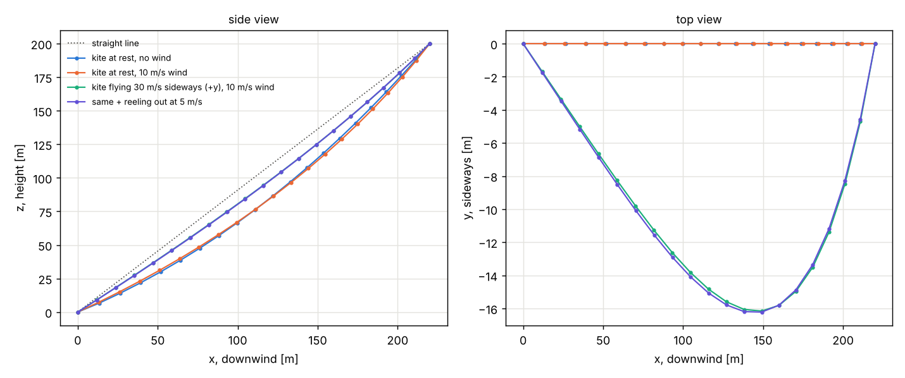</p>

*`examples_simple/01_static_tether.py`: a 300 m tether to a kite at (220, 0, 200) m.
Side view: at rest it sags (34 N at the drum). When the kite flies at 30 m/s the tension
rises to about 410 N and the tether straightens. Top view: a kite moving sideways (+y)
drags the tether behind it by up to 16 m.*

---

## 11. Block C: aerodynamics and pitch trim

### The coefficients

```math
q = \tfrac12\rho v_a^2,\qquad L = qSC_L(\alpha),\qquad D = qSC_D(\alpha),\qquad
E = \frac{C_L}{C_D},\qquad C_R = \sqrt{C_L^2 + C_D^2}
```

Here $v_a$ is the apparent wind (the wind the kite feels, including its own motion),
$S = 19.41$ m² the projected area and $\alpha$ the angle of attack.
$C_M$ is the pitching moment coefficient about the bridle point (KCU):
$C_M = M_y/(qSc)$ with $c = 2.60$ m.

### Where the numbers come from

V3Kite.jl computes its aerodynamics with the **Vortex Step Method (VSM)**, a fast TU Delft
method. It represents the curved wing as spanwise panels, each with a bound vortex, and
corrects the circulation with 2-D airfoil polars from CFD. V3Kite.jl needs 16 GB of RAM
or more and a long Julia build. Instead, `scripts/identify_aero_vsm.py` runs the
**Python VSM** directly on the same V3 geometry, polars and bridle lines:

- geometry: `aero_geometry_CAD_CFD_polars.yaml` (CAD shape, 2-D CFD polars), 40 panels;
- bridle lines: `struc_geometry_manually_adjusted.yaml` (line drag included);
- a sweep α = −6…20° at $v_a$ = 20 m/s;
- outputs: $C_L$, $C_D$ (wing alone and wing + bridle), $C_S$ vs side-slip, and $C_M$ about
  the KCU for ten depower states.

The result is `softkite/data/v3_aero.yaml`. The simulation only reads this table, so it
does not need the VSM. The KCU drag is added on top
($C_{D,KCU} = 0.059/19.41 = 0.003$), plus an optional user-set `cd_extra`:

```math
C_D(\alpha) = C_{D,\,wing+bridle}^{VSM}(\alpha) + \frac{(C_DA)_{KCU}}{S} + C_{D,\,extra}
```

### Pitch trim: how depower sets the angle of attack

A soft kite has no tail. It hangs from its bridle like a weathervane from its pivot.
The wing pitches until the aerodynamic moment about the KCU vanishes. This **trim**
takes a fraction of a second, much less than the flight-path time scales, so the model
uses the quasi-static trim angle directly:

```math
C_{M,KCU}\big(\alpha_{trim},\,\delta(u_p)\big) = 0,\qquad \frac{\partial C_M}{\partial\alpha} < 0\ \ \text{(stable)}
```

Depower lengthens the rear lines, which is the same as shortening the front lines by
$\delta$ relative to the CAD geometry. That moves the KCU forward under the wing and lowers
the trim angle. Following VSM's `compute_trim_angle.py`, the KCU position is the
intersection of two circles around the mid-span leading and trailing edge, with radii
$L_b - \delta$ and $L_t$. The powered state is $\delta = -0.036$ m and the depowered state
$\delta = +0.66$ m. The relative depower $u_p$ maps onto $\delta$ through the V3 depower-tape
calibration (V3Kite.jl `ld_2025`):

```math
\ell(u) = -1.7237\cdot10^{-4}(100u)^2 + 0.066238\,(100u) + 0.192\ \text{m},\qquad
\delta(u_p) = \delta_{pow} + \frac{\ell(u_p)-\ell(0.22)}{\ell(0.40)-\ell(0.22)}\,(\delta_{dep}-\delta_{pow})
```

<p align="center">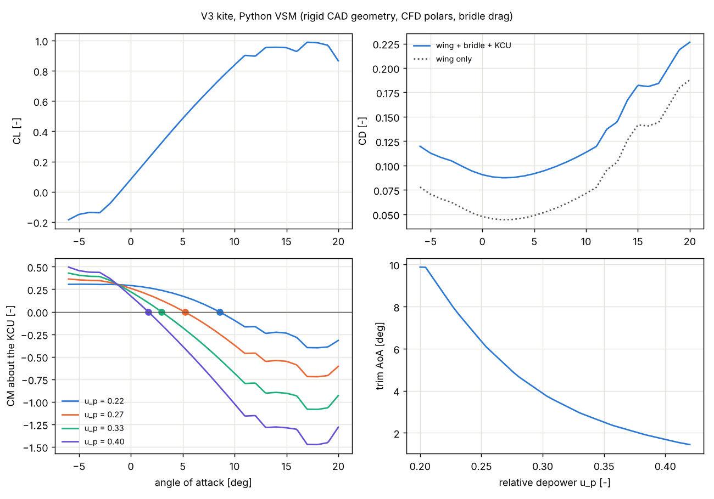</p>

*Top left: lift is nearly linear up to about 11°, then the wing starts to stall. Top
right: bridle lines and KCU add about 0.04 to the drag of the bare wing (dotted).
Bottom left: moment about the KCU for four depower settings; each crosses zero (dot)
with a negative slope, so the trim is stable. Bottom right: the trim angle falls from
10° to 1.5° as depower goes from 0.20 to 0.42.*

| u_p | α_trim | C_L | C_D | L/D | used for |
|---|---|---|---|---|---|
| 0.22 | 8.56° | 0.743 | 0.106 | 7.0 | fully powered |
| 0.25 | 6.35° | 0.586 | 0.096 | 6.1 | reel-out |
| 0.30 | 3.88° | 0.397 | 0.089 | 4.5 | transition |
| 0.35 | 2.51° | 0.286 | 0.088 | 3.3 | constant-length eights |
| 0.40 | 1.69° | 0.220 | 0.088 | 2.5 | reel-in |

Side force: $C_S = C_{S,\beta}\,\beta_s$ with $C_{S,\beta} = 1.06$ /rad at the powered trim (VSM).

> **Main caveat.** These are **rigid-wing** numbers: the canopy keeps its CAD shape. A
> flying V3 billows, twists and flutters, which costs efficiency. Flight-derived glide
> ratios are about 3.6–4.5, not 6.1. See [section 17](#17-verification-and-validation)
> for what this does to the results and how `cd_extra` corrects it.

---

## 12. Block D: kite motion and steering

### Equation of motion

Wing and KCU form one point mass $m$ = 19 kg at the bridle point:

```math
m\,\dot{\mathbf v}_k = \mathbf L + \mathbf D + \mathbf F_s + m\mathbf g + \mathbf F_t,\qquad \dot{\mathbf p}_k = \mathbf v_k
```

with the apparent wind $\mathbf v_a = \mathbf v_w(z) - \mathbf v_k$ and

```math
\mathbf L = qSC_L\,\frac{\hat y_k\times\mathbf v_a}{|\hat y_k\times\mathbf v_a|},\qquad
\mathbf D = qSC_D\,\hat{\mathbf v}_a,\qquad
\mathbf F_s = qS\,C_{S,\beta}\,\beta_s\,\hat s,\qquad
\beta_s = \arcsin(\hat{\mathbf v}_a\cdot\hat y_k)
```

$\hat s$ is the part of the span axis normal to $\mathbf v_a$, and $\mathbf F_t$ is the tether
force from block B.

- **Lift** is normal to the apparent wind and to the span axis.
- **Drag** points along the apparent wind.
- **Side force** acts only when the kite slips sideways through the air, and makes the
  flight direction follow the nose (time constant about 0.03–0.1 s).

<p align="center">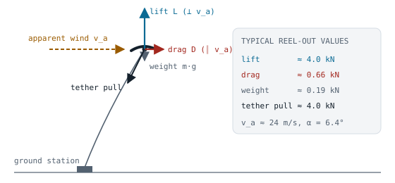</p>

*Force balance, drawn for a kite hanging still in the wind so that all forces lie in one
plane. In crosswind flight the apparent wind comes mostly from the kite's own speed
(about 24 m/s), so lift grows to about 4 kN, twenty times the kite's weight.*

### Steering: an identified turn-rate law

How a soft kite turns is complicated: pulling one steering line twists and deforms the
canopy. Instead of modelling that, the heading follows a law fitted by
RobustKiteControllers.jl to many V3Kite.jl simulations (`softkite/data/v3_turn_rate_coeffs.yaml`):

```math
\dot\psi = c_1(u_p)\,v_a\,u_{s,f} + \frac{c_2(u_p)}{v_a}\,\sin\psi\cos\beta
```

The first term is steering. The second is gravity turning the nose downward.

The applied steering $u_{s,f}$ is the command after:

1. the KCU rate limit;
2. the identified **dead time** $\tau_d$;
3. a first-order **kite lag** $\tau_k$:
   $\dot u_{s,f} = \big(u_s(t-\tau_d) - u_{s,f}\big)/\tau_k$.

The coefficients are interpolated in depower, log-linearly for $c_1$, and clamped
outside the table:

| u_p | c₁ [1/m] | c₂ [m/s²] | dead time [s] | kite lag [s] |
|---|---|---|---|---|
| 0.200 | 0.348 | 1.72 | 0.083 | 0.056 |
| 0.250 | 0.314 | 2.54 | 0.117 | 0.078 |
| 0.300 | 0.233 | 3.69 | 0.139 | 0.067 |
| 0.350 | 0.166 | 3.77 | 0.161 | 0.056 |
| 0.375 | 0.144 | 3.87 | 0.183 | 0.022 |

Example: at u_p = 0.25 and v_a = 24 m/s, u_s = 0.1 gives about 0.75 rad/s (43°/s).

---

## 13. Block E: KCU actuators and winch

**KCU** (`KCU` class, run at the control rate):

- depower rate limit 0.075 /s, so 0.25 → 0.40 takes 2 s;
- steering rate limit 2 /s and steering limit ±0.32;
- steering dead time from the turn-rate table (can be disabled with `use_delay: false`).

**Winch.** The drum and generator inertia act as a mass $m_w$ = 120 kg at the drum
radius. A motor speed loop with time constant $\tau$ = 0.1 s tracks the set-point,
within a motor force limit of 5 kN:

```math
m_w\,\dot v_r = F_{gnd} - F_m,\qquad
F_m = \operatorname{clip}\!\Big(F_{gnd} - m_w\frac{v_{set}-v_r}{\tau},\ \pm F_{m,max}\Big),\qquad
\dot l = v_r
```

**Mechanical power at the drum:** $P = F_{gnd}\,v_r$, positive when reeling out. All powers
in this README are this mechanical power. Electrical power would be roughly 10–20 % lower
after drivetrain and storage losses, which are not modelled.

---

## 14. Block F: controllers (the pilot)

All controllers take the observation dict (`KiteModel.out`) and return
`(u_s_set, u_p_set, v_set)` every 20 ms. They are layered.

### Inner loop: course and heading (`controllers/course.py`)

Nonlinear inversion of the turn-rate law. A desired turn rate is set from the angle
error plus an optional path-curvature feed-forward, and the law is solved for the
steering:

```math
r_{des} = k_\psi\,e + \dot\chi_{ff},\qquad
u_s = \operatorname{clip}\!\left(\frac{r_{des} - \frac{c_2}{v_a}\sin\psi\cos\beta}{c_1\,v_a},\ \pm0.32\right)
```

- $k_\psi$ = 2.5 rad/s is the loop bandwidth.
- Dividing by $c_1 v_a$ is the gain scheduling of RobustKiteControllers.jl: gentler
  steering at high speed.
- The error $e$ uses the heading below 5 m/s tangential speed and the course above
  10 m/s, blended on the unit circle in between.

### Middle loop: figure-of-eight guidance (`controllers/figure_eight.py`)

The path is a lemniscate of Gerono in (azimuth, elevation):

```math
\phi(s) = \phi_c + A\sin s,\qquad \beta(s) = \beta_c + H\sin 2s
```

The defaults are A = 25° wide, H = 9° high and β_c = 28°. By default the eight is flown
with **up-turns**: climbing at the sides and diving diagonally through the centre,
which keeps force peaks lower. Guidance is **carrot chasing**:

1. Find the nearest point of the path (local search ahead of the last one).
2. Move 5° of arc further along the path to the "carrot" (further when far off the path).
3. Command the course towards it:
   $\chi_{set} = \operatorname{atan2}\big(-(\phi_t-\phi)\cos\beta,\ \beta_t-\beta\big)$.
4. Feed forward the path's course rate at the carrot (gain 0.8).

### Winch control (`controllers/winch.py`)

| Mode | Law | Used in |
|---|---|---|
| `reel_out` | $v = k_v\sqrt{F}$ + PI limiters: above `f_max` = 4 kN reel out faster, below `f_min` = 300 N reel in | reel-out (default) |
| `reel_out_force` | PI on $F - f_{ro}$ (constant force, e.g. 3 kN) | reel-out with `ro_mode: force` (2013 flights) |
| `reel_in` | $v = -v_{ri}$ (7 m/s) + PI limiters: above `f_ri` = 1.2 kN reel in slower, below `f_min` faster | reel-in |
| `speed` | follow a speed (0 in the transition), upper limiter active | transition, parking |
| `hold` | zero speed, no limiter | constant-length eights |

The set-point is acceleration-limited to 4 m/s². The gain $k_v$ is tuned from the aero
tables for an optimal reel-out factor $f = v_{ro}/v_w \approx 1/3$ (quasi-steady
theory):

```math
k_v = \frac{f}{(1-f)\,K},\qquad K = \sqrt{\tfrac12\rho S C_R(1+E^2)},\qquad E = 0.85\,\frac{C_L}{C_D}
```

The factor 0.85 accounts for tether drag. The default is $k_v$ = 0.036 m/s/√N.

### Outer loop: the pumping cycle (`controllers/pumping.py`)

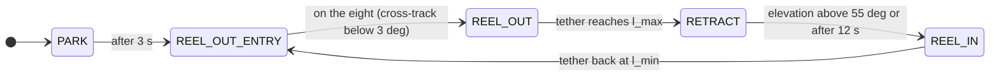

| Phase | Depower | Steering | Winch | Ends when |
|---|---|---|---|---|
| PARK | 0.40 | heading up, azimuth hold | stopped | after 3 s (start-up only) |
| REEL_OUT_ENTRY | → 0.25 | dive into the eight | `reel_out` | cross-track < 3° |
| REEL_OUT | 0.25 | figure eight | `reel_out` | l ≥ `l_max` = 350 m |
| RETRACT | 0.30 | climb to (φ = 0, β = 70°) | `speed` 0 (limiter still pays out about 15 m) | β > 55° or 12 s |
| REEL_IN | 0.40 | heading up, azimuth hold: ψ_set = 1.5·φ (±35°) | `reel_in`, slowed above 70° elevation (to 20 % at 80°) | l ≤ `l_min` = 200 m |

The reel-in elevation guard exists because a depowered kite drifts toward the zenith
while being reeled in. Passing the zenith would be dangerous.

Two simpler controllers are also included. `ParkingController` holds the kite near the
zenith at constant length. `Fig8Controller` flies eights at constant length with depower
`u_p_f8` = 0.35.

---

## 15. Simulation loop and numerics

Every control period (`dt` = 20 ms):

1. The controller reads `KiteModel.out` and returns `(u_s_set, u_p_set, v_set)`.
2. The KCU applies rate limits and the steering dead time.
3. The state is advanced with **RK4** in `substeps` = 2 steps of 10 ms. Every RK4 stage
   evaluates wind → tether solve → aerodynamics → forces → derivatives.
4. Outputs (forces, angles, coefficients, tether nodes) are recomputed at the new state
   and logged.

Speed is about 20x real time with numba and about 10x without. A crash is flagged if the
kite goes below 1 m or the state becomes non-finite.

---

## 16. Reading the results

All figures come from the default run (`examples_simple/05_pumping_cycle.py`). The
shading shows the phase: blue reel-out, orange transition, green reel-in.

### One full cycle, panel by panel

<p align="center">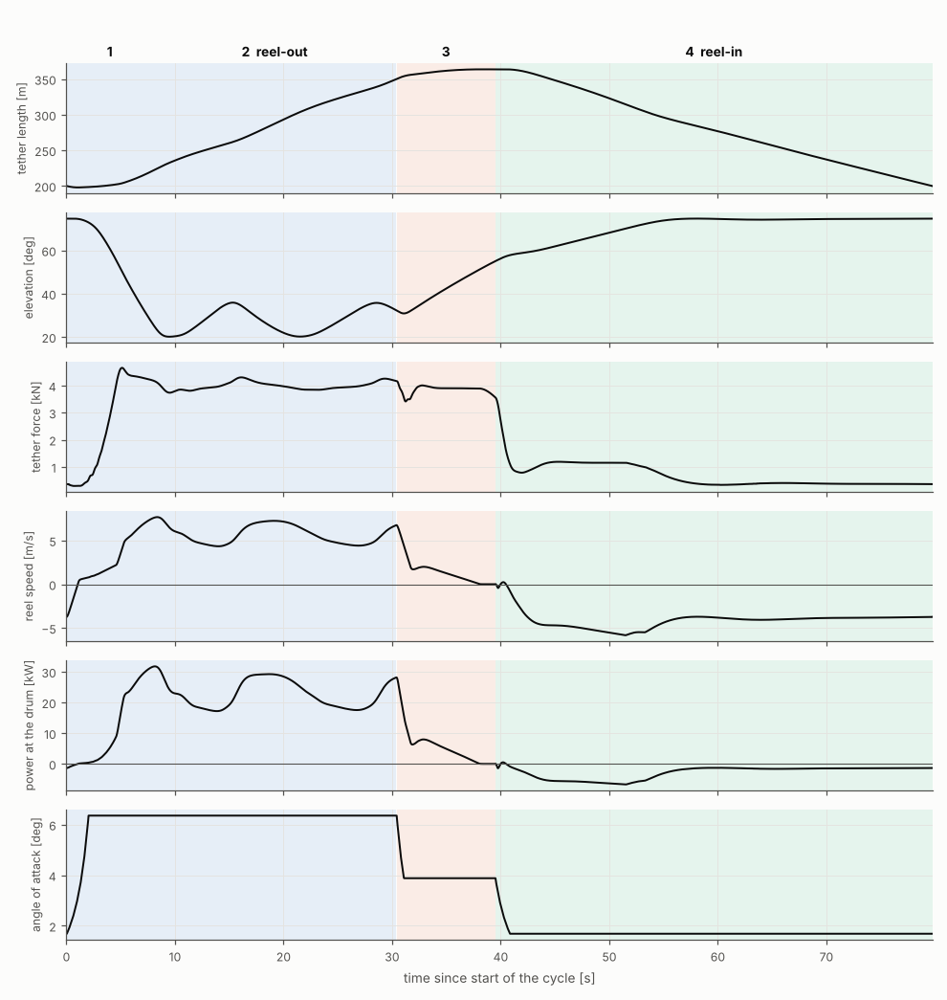</p>

The bold numbers above the top panel are the phases: 1 entry, 2 reel-out,
3 transition, 4 reel-in.

- **Tether length** grows from 200 m to 345 m in reel-out (0–30 s), creeps to 365 m in
  the transition (the force limiter pays out while the kite still pulls 3.9 kN), then
  returns to 200 m in reel-in.
- **Elevation** drops from 75° into the eight (20–36°), oscillating twice per eight. It
  climbs to about 55° in the transition and levels at about 75° during reel-in.
- **Tether force** sits at the 4 kN limit throughout reel-out; that is the limiter
  working. The 4.65 kN peak comes from the dive into the eight. Force is 1.2 kN at the
  start of reel-in (the reel-in limit), then about 0.4 kN.
- **Reel speed** is +4.4 to +7.7 m/s in reel-out (mean 5.7) and about −4 m/s in reel-in.
  The set-point (dashed in `plot_timeseries`) lies on top of the actual speed.
- **Power** is 17–32 kW in reel-out (mean 23 kW) and −2 to −7 kW in reel-in. That
  asymmetry is the point of pumping.
- **Angle of attack** moves in steps (6.4° → 3.9° → 1.7°) because it is the trim angle
  per depower setting, ramped at 0.075 /s. Real wings oscillate slightly around it; this
  model leaves that out by design.

Energy of this cycle: **659 kJ out, 111 kJ in, net 548 kJ in 80 s, so 6.9 kW mean**.
Cycles 2 and 3 agree to within 0.1 %: the cycle is periodic and stable.

### Why reel-out power oscillates

<p align="center">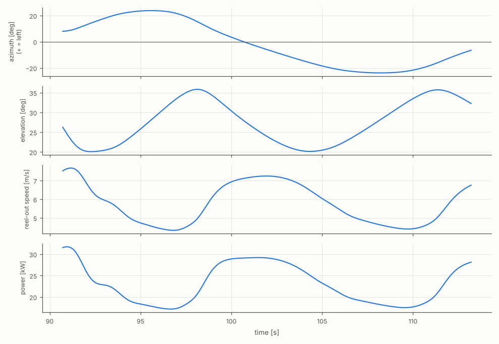</p>

With the force held at 4 kN, power follows the reel-out speed. The reel-out speed
follows the wind component into the flight zone, roughly $v_w\cos\beta\cos\phi$.

- At the sides of the eight (φ ≈ ±23°, β ≈ 36°, climbing against gravity), power dips
  to about 17 kW.
- Through the centre (diving), it peaks at about 29 kW.

Two side turns per eight give two dips per eight.

### Reel-in and the zenith guard

<p align="center">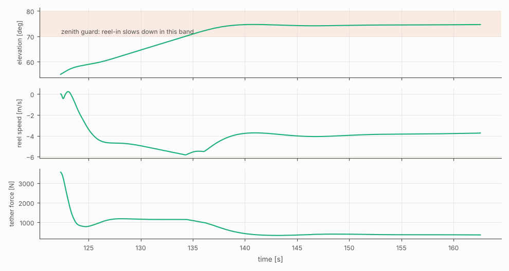</p>

Reel-in starts at 55° elevation, limited at 1.2 kN. As the kite climbs into the
70–80° band the controller slows the reel-in to about 4 m/s and the elevation settles at
75°. This guard is why reel-in takes half the cycle (see [roadmap](#28-roadmap)).

### Flight path and power curve

<p align="center">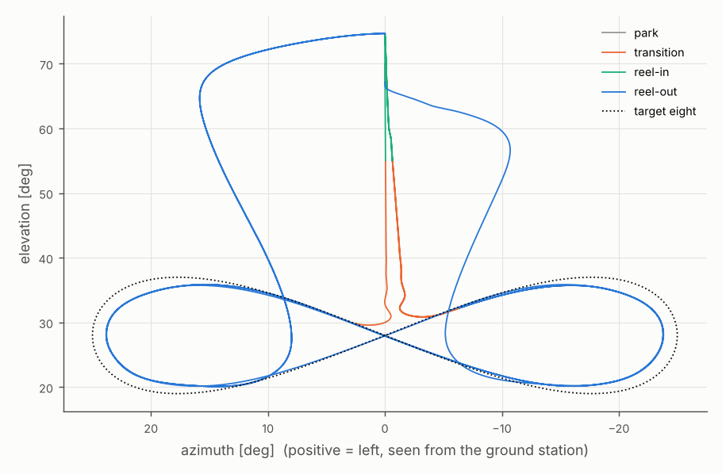 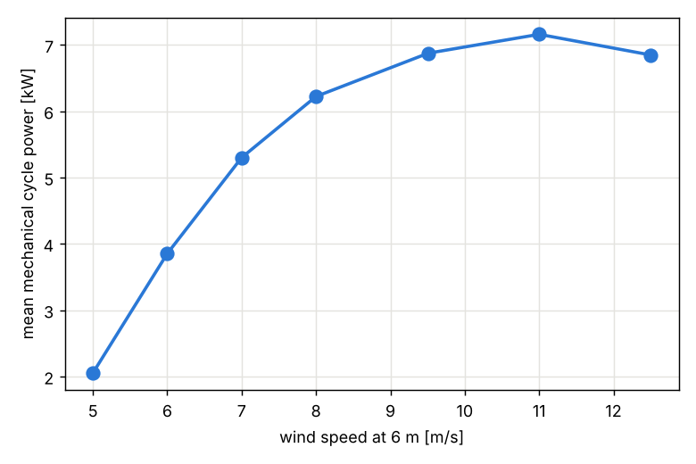</p>

**Left:** the flight path as seen from the ground station.

- The eight (blue) stays within about 1° RMS of the dotted target and is slightly
  smaller, because the look-ahead cuts corners.
- Transitions (orange) climb straight up from the centre.
- Reel-in (green) holds azimuth 0.
- The long loops from the top are the dives into the eight.

**Right:** mean mechanical cycle power vs wind speed at 6 m.

| v_wind at 6 m [m/s] | 5 | 6 | 7 | 8 | 9.51 | 11 | 12.5 |
|---|---|---|---|---|---|---|---|
| mean cycle power [kW] | 2.05 | 3.85 | 5.30 | 6.22 | 6.87 | 7.16 | 6.85 |
| cycle time [s] | 141 | 116 | 97 | 83 | 80 | 84 | 102 |
| peak force [kN] | 3.8 | 4.2 | 4.3 | 4.4 | 4.7 | 5.3 | 5.8 |

Power rises steeply up to about 9 m/s and then flattens, because the force is capped at
4 kN and the reel-out depower is fixed. A real controller would depower further in
strong wind. That is a limitation of the baseline controller, not of the kite model.

---

## 17. Verification and validation

**Verification** asks whether the code solves its equations correctly. **Validation**
asks whether those equations describe the real kite.

### Verification

| Check | Result |
|---|---|
| Tether vs the reference case of the original MATLAB implementation (`tests/data/*.mat`) | identical to 9+ digits |
| Tether without wind vs the exact catenary | error shrinks with segment count; < 0.5 % of sag at 160 segments |
| Tether vertical force balance at rest | difference = tether weight |
| Trim angles | C_M = 0 at trim, negative slope, for all depower settings |
| Simulated turn rate vs the law | exact |
| Steering sign, lift direction, side force | positive steering turns right; lift points outward; side-slip < 3° in steady flight |
| Winch speed tracking | within 0.05 m/s |
| Full pumping cycles | no crash, positive energy per cycle, periodic |

Run them with `python -m pytest` (19 tests).

### Consistency with theory

The simulation was compared with quasi-steady crosswind theory, evaluated sample by
sample with the same wind, angles and coefficients:

```math
F = \tfrac12\rho S C_R v_a^2,\qquad v_a = (v_w\cos\beta\cos\phi - v_{ro})\sqrt{1+E^2}
```

| Quantity | Simulation | Theory | Difference |
|---|---|---|---|
| Reel-out speed (default run) | 5.75 m/s | 5.91 m/s | −2.7 % |
| Apparent wind in reel-out | 23.97 m/s | 23.73 m/s | +1.0 % |
| Reel-out power | 23.0 kW | 23.6 kW | −2.5 % |
| Constant-length eight, u_p 0.25 (Loyd, $v_a = v_w\cos\beta\cos\phi\sqrt{1+E^2}$) | 58.1 m/s | 55.9 m/s | +3.9 % |
| Constant-length eight, u_p 0.35 (Loyd) | 31.1 m/s | 30.5 m/s | +2.0 % |

The small differences are gravity, inertia and curved flight, which the formulas
ignore.

### Validation against the 7 May 2013 flight

This flight of the 25 m² TU Delft kite is published by van der Vlugt et al. (2019),
Tables 1–3. Conditions:

- 5.9 m/s wind at 6 m, log profile with z₀ = 0.07 m;
- tether 234–385 m;
- constant-force reel-out at 3 kN and reel-in at 750 N.

These are in `softkite/data/settings_v3_flight2013.yaml`, and the comparison is
`examples_simple/09_validate_flight_2013.py`.

<p align="center">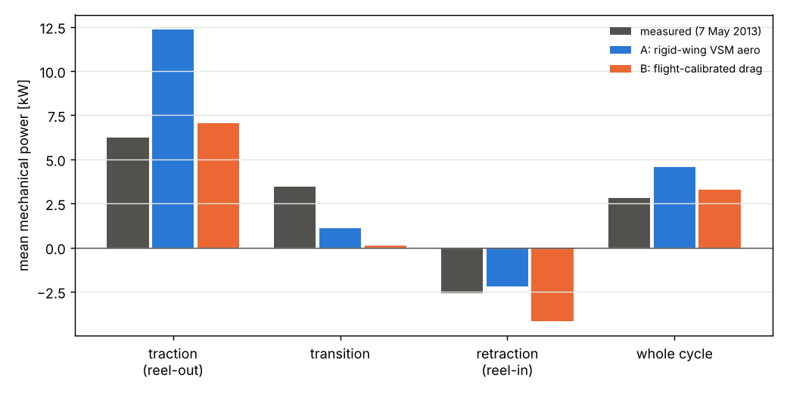</p>

| | Measured | A: VSM aero (`cd_extra` 0) | B: calibrated (`cd_extra` 0.067) |
|---|---|---|---|
| reel-out power / duration | 6.23 kW / 66 s | 12.4 kW / 38 s | 7.0 kW / 65 s |
| transition power / duration | 3.44 kW / 12 s | 1.1 kW / 12 s | 0.1 kW / 12 s |
| reel-in power / duration | −2.60 kW / 43 s | −2.2 kW / 37 s | −4.2 kW / 28 s |
| cycle mean power / duration | 2.79 kW / 122 s | 4.6 kW / 87 s | 3.3 kW / 105 s |
| energy per cycle | 341 kJ | 395 kJ | 345 kJ |
| reel-out glide ratio L/D | ≈ 3.6 | 6.1 | 3.6 |

How to read it:

- **What matches:** the resultant force coefficient (0.59–0.61 vs about 0.61), the
  flight height, the angles and the wind at the kite (10.0 vs 10.1 m/s). The force side
  of the model is right.
- **What doesn't, uncalibrated:** the rigid wing glides about 70 % better than the real
  kite. At the same force it reels out much faster, so reel-out power doubles.
- **With `cd_extra = 0.067`**, the glide ratio matches the flight value. Reel-out power
  and duration then agree within 13 % and 2 %, and energy per cycle within 1 %.
- **The cycle mean is still 18 % high.** The model reels in faster and produces almost
  nothing in the transition, whereas the 2013 flight reeled out through the transition
  and gained about 40 kJ there.
- **For comparison:** the paper's own quasi-steady model is 27 % high on this cycle with
  gravity included. It is within 2 % without gravity, which the authors call partly
  coincidental.

> **Source note.** The flight values C_R ≈ 0.61 and L/D ≈ 3.6 are a reading of
> unlabelled rows in Table 1 of the paper. They are consistent with its C_L of 0.59;
> other V3 studies use L/D = 4.5 (C_L 0.63, C_D 0.14). Confirm against the paper before
> citing. The phase powers and durations come from Tables 2 and 3 and are unambiguous.

### Comparison with V3Kite.jl

V3Kite.jl reports the apparent wind of its steering-identification runs (150 m tether,
9.51 m/s). `examples_simple/08_compare_v3kite_vapp.py` flies the same conditions:

| u_p | 0.20 | 0.25 | 0.30 | 0.325 | 0.35 | 0.375 |
|---|---|---|---|---|---|---|
| V3Kite.jl v_a [m/s] | 52.1 | 44.6 | 35.7 | 34.5 | 31.0 | 23.9 |
| this model [m/s] | 70.3 | 58.1 | 42.5 | 36.4 | 31.1 | 26.6 |

The two agree when depowered and diverge when powered, by up to 35 %. That is the same
rigid-vs-deforming effect. Matching V3Kite.jl at u_p = 0.25 needs `cd_extra` ≈ 0.03.

### Choosing the drag setting

| `kite.cd_extra` | Meaning | Use when |
|---|---|---|
| 0.0 (default) | pure VSM rigid-wing physics, traceable | studying trends where absolute efficiency doesn't matter, or comparing with other rigid-wing VSM results |
| ≈ 0.03 | matches V3Kite.jl at reel-out depower | comparing with V3Kite.jl |
| 0.067 | matches the 2013 flight glide ratio | absolute power and energy estimates for the V3 |

State the value you used when you report results.

---

## 18. Is it good enough? Scope of use

| Requirement of a reference model | Status |
|---|---|
| Defined system with documented, sourced parameters | met |
| Easy to install and run | met: four packages, 10–20x real time |
| Baseline controller with full pumping cycle | met: stable 5–12.5 m/s |
| Verification | met: 19 tests, MATLAB reference, theory within 3 % |
| Validation against measurements | partly: force side matches; efficiency needs one calibrated drag value; one flight case so far |
| Fidelity for detailed dynamics | not intended (3-DOF) |

**Use it for:**

- pumping-cycle and controller development;
- comparing operating strategies (tether lengths, depower settings, patterns);
- system-level, LCoE and scaling trends (with calibrated drag);
- teaching;
- a fast plant for testing ideas before V3Kite.jl.

**Do not use it for:**

- structural loads;
- canopy deformation;
- pitch or roll oscillations;
- the inertia-driven lag between flight path and attitude at high wing loading (Cayon et
  al. 2026);
- gust or turbulence response;
- absolute power predictions with `cd_extra = 0`.

---

## 19. Assumptions and limitations

**Kite**

- Point mass, so no rotational dynamics. Attitude follows from heading and the
  apparent wind.
- Angle of attack = quasi-static trim. Pitch oscillations and pitch-rate effects are
  ignored. The wing's own weight moment about the KCU is ignored; it shifts the trim by an
  estimated 0.5° or less, even at low speed.
- Rigid CAD shape. Deformation enters only through the depower geometry (and
  `cd_extra`).
- Steering affects only the turn rate, not lift or drag.
- The turn-rate law is identified at one condition (150 m, 9.51 m/s, low elevation) and
  clamped outside 0.2 ≤ u_p ≤ 0.375. The steady-flight course is assumed to follow the
  identified heading law.
- No added mass, no Reynolds-number effects (fixed polars).

**Tether**

- Quasi-steady: no tether waves or transverse oscillations.
- Straight-line height approximation for the wind at the nodes.
- Uniform material, linear elasticity, cylinder drag normal to each segment.

**Environment**

- Steady, uniform-direction wind with shear and no turbulence. Constant air density.

**Ground station**

- A drum inertia with an ideal speed loop and force limit. No drivetrain or storage
  losses (mechanical power only).

**Controller** (the baseline, not an optimum)

- Fixed reel-out depower: no depower adaptation in strong wind.
- The reel-in zenith guard makes reel-in slow, about half the cycle.
- Little energy in the transition.
- Force peaks at the dive into the eight (1.2–1.5x `f_max` in strong wind).
- No sensors or estimation: the controller reads true states.

---

## 20. Configuration reference

All settings live in `softkite/data/settings.yaml`. Each key maps to a field of the
dataclasses in `softkite/settings.py` (the defaults there are identical). Override in
code with `load_settings(section__key=value)`, or pass another YAML file as
`load_settings(path)`; missing keys then fall back to the dataclass defaults.

### `environment`

| Key | Default | Unit | Meaning | Source |
|---|---|---|---|---|
| `v_wind_ref` | 9.51 | m/s | wind speed at the reference height | V3Kite.jl / KiteUtils |
| `h_ref` | 6.0 | m | reference height | KiteUtils |
| `profile_law` | `power` | – | `power` or `log` | – |
| `profile_exp` | 0.08163 | – | power-law exponent | KiteUtils |
| `z0` | 0.07 | m | roughness length (log law) | van der Vlugt et al. 2019 |
| `wind_dir` | 0.0 | deg | wind direction (0 = along +x) | – |
| `rho` | 1.225 | kg/m³ | air density | ISA |
| `g` | 9.81 | m/s² | gravity | – |

### `kite`

| Key | Default | Unit | Meaning | Source |
|---|---|---|---|---|
| `aero_file` | `v3_aero.yaml` | – | aero table in `softkite/data/` or an absolute path | `identify_aero_vsm.py` |
| `turn_rate_file` | `v3_turn_rate_coeffs.yaml` | – | turn-rate table | RobustKiteControllers.jl |
| `m_wing` | 10.6 | kg | wing mass incl. bridle | V3 reported |
| `m_kcu` | 8.4 | kg | KCU mass | V3Kite.jl |
| `cd_kcu_area` | 0.059 | m² | KCU drag area C_D·A | KiteUtils |
| `cd_extra` | 0.0 | – | extra drag coefficient (calibration) | see section 17 |
| `u_p_powered` | 0.22 | – | depower of the powered reference state (δ = −0.036 m) | KiteControllers.jl |
| `u_p_depowered` | 0.40 | – | depower of the depowered reference state (δ = 0.66 m) | KiteControllers.jl |

### `kcu`

| Key | Default | Unit | Meaning |
|---|---|---|---|
| `v_depower` | 0.075 | 1/s | depower rate limit (V3Kite.jl) |
| `v_steering` | 2.0 | 1/s | steering rate limit |
| `max_steering` | 0.32 | – | steering command limit (RobustKiteControllers.jl) |
| `use_delay` | true | – | apply the identified steering dead time |

### `tether`

| Key | Default | Unit | Meaning |
|---|---|---|---|
| `segments` | 10 | – | number of tether segments |
| `d_tether` | 4.0 | mm | diameter |
| `cd_tether` | 0.958 | – | drag coefficient (normal flow) |
| `rho_tether` | 724.0 | kg/m³ | material density |
| `c_spring` | 614600 | N | axial stiffness E·A |

### `winch`

| Key | Default | Unit | Meaning |
|---|---|---|---|
| `m_eff` | 120.0 | kg | drum and motor inertia as a mass at the drum radius |
| `tau_speed` | 0.1 | s | speed-loop time constant |
| `f_motor_max` | 5000 | N | motor force limit at the drum |
| `v_ro_max` | 8.0 | m/s | max reel-out speed |
| `v_ri_max` | 8.0 | m/s | max reel-in speed |
| `a_max` | 4.0 | m/s² | set-point acceleration limit |

### `simulation`

| Key | Default | Unit | Meaning |
|---|---|---|---|
| `dt` | 0.02 | s | control and logging period |
| `substeps` | 2 | – | RK4 steps per control period |
| `l_tether0` | 200.0 | m | initial tether length |
| `elevation0` | 70.0 | deg | initial elevation |
| `azimuth0` | 0.0 | deg | initial azimuth |
| `heading0` | 0.0 | deg | initial heading (0 = nose up) |
| `depower0` | 0.40 | – | initial depower |
| `sim_time` | 400.0 | s | default run time |

### `control`

| Key | Default | Unit | Meaning |
|---|---|---|---|
| `k_psi` | 2.5 | rad/s | heading/course loop bandwidth |
| `k_psi_d` | 0.0 | – | derivative gain on the error rate |
| `v_heading` | 5.0 | m/s | below: heading feedback only |
| `v_course` | 10.0 | m/s | above: course feedback only |
| `f8_azimuth` | 25.0 | deg | half width A of the eight |
| `f8_height` | 9.0 | deg | elevation amplitude H |
| `f8_elevation` | 28.0 | deg | centre elevation β_c |
| `f8_lookahead` | 5.0 | deg | carrot distance along the path |
| `f8_up_turns` | true | – | climb in the side turns |
| `u_p_ro` | 0.25 | – | depower during reel-out |
| `u_p_ri` | 0.40 | – | depower during reel-in |
| `u_p_tr` | 0.30 | – | depower during the transition climb |
| `u_p_f8` | 0.35 | – | depower for constant-length eights |
| `ri_elevation` | 70.0 | deg | aim point of the transition climb |
| `tr_elevation` | 55.0 | deg | elevation that ends the transition |
| `tr_time_max` | 12.0 | s | maximum transition duration |
| `ro_exit_wait` | 0.0 | s | at `l_max`, wait at most this long for the kite to climb |
| `ri_beta_max` | 80.0 | deg | reel-in speed cut to 20 % at this elevation |
| `ri_beta_band` | 10.0 | deg | band below `ri_beta_max` over which reel-in slows |
| `k_azimuth` | 1.5 | – | azimuth → heading gain while parked (±35°) |
| `l_min` | 200.0 | m | reel-in ends here |
| `l_max` | 350.0 | m | reel-out ends here |
| `f_ro_factor` | 0.333 | – | reel-out factor for tuning k_v |
| `ro_mode` | `sqrt` | – | `sqrt` (v = k_v√F) or `force` (constant `f_ro`) |
| `f_ro` | 3000.0 | N | reel-out force set-point (`ro_mode: force`) |
| `f_max` | 4000.0 | N | upper force limit (reel-out, transition) |
| `f_min` | 300.0 | N | lower force limit |
| `f_ri` | 1200.0 | N | upper force limit during reel-in |
| `v_ri` | 7.0 | m/s | reel-in speed set-point |
| `kp_force` | 0.002 | m/s/N | P gain of the force limiters |
| `ki_force` | 0.004 | m/s/N/s | I gain of the force limiters |

`softkite/data/settings_v3_flight2013.yaml` holds the 2013 flight conditions
([section 17](#17-verification-and-validation)).

---

## 21. Outputs: the log and cycle statistics

`Simulation.run()` returns a `SimLog`. Each key is a NumPy array over time, sampled
every `dt`. Save it with `log.save("run.npz")` and load it with
`SimLog.load("run.npz")`. `log.meta` holds the settings, phase names, transitions and
wall time.

| Key | Unit | Meaning |
|---|---|---|
| `time` | s | simulation time |
| `pos`, `vel` | m, m/s | kite position and velocity (N×3, W frame) |
| `l_tether` | m | unstretched tether length |
| `v_reel`, `v_set` | m/s | reel speed and its set-point (+ = out) |
| `f_gnd` | N | tether tension at the drum |
| `f_motor` | N | motor force at the drum |
| `power` | W | mechanical power at the drum, `f_gnd·v_reel` |
| `v_a` | m/s | apparent wind speed at the kite |
| `v_wind` | m/s | wind speed at the kite height |
| `alpha` | deg | angle of attack (trim) |
| `cl`, `cd`, `cs`, `cm` | – | aerodynamic coefficients in use (cm about the KCU) |
| `side_slip` | rad | side-slip angle |
| `heading`, `course`, `chi_set` | rad | heading, course and commanded course |
| `beta`, `phi` | rad | elevation and azimuth |
| `v_tangential` | m/s | kite speed tangential to the sphere |
| `distance`, `height` | m | distance from the ground station, height |
| `u_s`, `u_s_lagged`, `u_p` | – | applied steering (after rate limit and delay), after the kite lag, depower |
| `psi_dot` | rad/s | turn rate |
| `c1`, `c2` | 1/m, m/s² | turn-rate coefficients in use |
| `x_k`, `y_k`, `e_r` | – | nose, span and radial unit vectors (N×3) |
| `tether_nodes` | m | tether points from the drum to the kite (N×3×(segments+1)) |
| `tether_ok` | – | tether solver converged |
| `phase` | – | index into `PHASES = [park, reel_out_entry, reel_out, retract, reel_in]` |
| `cycle` | – | pumping-cycle counter |

`cycle_stats(log)` returns one dict per **complete** cycle (from REEL_OUT_ENTRY to the
next one) with these keys:

- `cycle`, `duration`;
- `energy_out`, `energy_in`, `energy` [J], `mean_power` [W];
- `f_max`, `v_ro_max`, `v_ri_max`;
- `t_<phase>` (time per phase);
- `mean_power_ro`, `mean_force_ro`, `mean_v_ro`, `mean_cl_ro`, `mean_alpha_ro`, `mean_va_ro`;
- `mean_force_ri`, `mean_v_ri`.

---

## 22. Python API

```python
from softkite import (load_settings, Settings, Simulation, SimLog, run, cycle_stats,
                      KiteModel, StaticTether, StaticSettings, AeroModel, TurnRateLaw, DepowerMap)
from softkite.controllers import (PumpingCycleController, Fig8Controller, ParkingController,
                                  CourseController, FigureEight, WinchController, tune_k_v)
from softkite.viewer import replay, plot_timeseries, plot_pattern, plot_3d
```

| Object | Main calls |
|---|---|
| `load_settings(path=None, **overrides)` | returns `Settings`; overrides like `control__l_max=400` |
| `Simulation(settings, controller_cls=PumpingCycleController, **controller_kwargs)` | `.run(sim_time, verbose=True, stop_after_cycles=None, l_tether=, elevation=, azimuth=, heading=, depower=)` returns `SimLog`; `.model`, `.controller` |
| `KiteModel(settings)` | `.init(...)`, `.step(u_s_set, u_p_set, v_set)`, `.out` (observation dict), `.y` (state), `.wind_speed(z)`, `.aero`, `.turn`, `.tether` |
| `StaticTether(StaticSettings(...))` | `.init(kite_pos, tether_length)`, `.step(kite_pos, kite_vel, tether_length, wind_vel)`; results `.force_kite`, `.force_gnd`, `.state_vec`, `.nodes()`, `.converged` |
| `AeroModel(path, cd_kcu_area, cd_extra, depower_map)` | `.cl(α)`, `.cd(α)`, `.alpha_trim(u_p)`, `.cm(α, u_p)`, `.summary()` |
| `TurnRateLaw(path)` | `.c1(u_p)`, `.c2(u_p)`, `.delay(u_p)`, `.kite_lag(u_p)`, `.rate(u_s, v_a, ψ, β, u_p)` |
| `PumpingCycleController(settings, model, park_time=3.0)` | `.update(obs)` returns `(u_s, u_p, v_set)`; `.phase`, `.cycle`, `.transitions` |
| `Fig8Controller(settings, model, depower=None, hold_length=True)` | constant-length eights |
| `ParkingController(settings, model, depower=None)` | hold near zenith |
| `replay(log, speed=4, fps=20, tail=30, kite_scale=4, save=None, t_range=None, show=True)` | 3-D animation; `save="x.mp4"` (ffmpeg) or `"x.gif"` |
| `plot_timeseries(log, path=None, t_range=None)`, `plot_pattern(log, fig8, path)`, `plot_3d(log, path)` | static figures |

**Your own controller.** Write any class with `__init__(self, settings, model, ...)`, an
`update(self, obs)` method returning `(u_s_set, u_p_set, v_set)`, and attributes `phase`
(one of `PHASES`), `cycle` and `chi_set`. Then pass it as `Simulation(s, MyController)`.

**Driving the model directly**, without `Simulation`:

```python
m = KiteModel(load_settings()).init(l_tether=250, elevation=40, depower=0.3)
for _ in range(500):
    m.step(u_s_set=0.0, u_p_set=0.3, v_set=0.0)
print(m.out["f_gnd"], m.out["v_a"])
```

---

## 23. Examples

All in `examples_simple/`. Run them from the repository root. Outputs go to `output/`.

| Script | What it does | Runtime |
|---|---|---|
| `01_static_tether.py` | tether shape and forces at rest, in wind, crosswind, reeling (side and top view) | seconds |
| `02_aero_coefficients.py` | CL, CD, CM(KCU) vs α and trim α vs depower; prints the table | seconds |
| `03_parking.py` | parks the kite near the zenith at constant length | ~3 s |
| `04_figure_eight.py` | figures of eight at constant 150 m | ~5 s |
| `05_pumping_cycle.py [sim_time] [v_wind]` | full pumping cycles, cycle table, plots, log `output/pumping.npz` | ~15 s |
| `06_replay.py [log] [--save x.mp4] [--speed] [--t0 --t1]` | 3-D replay of any log | live / ~1 min to save |
| `07_power_curve.py` | mean cycle power vs wind speed | ~2–3 min |
| `08_compare_v3kite_vapp.py` | constant-length eights vs V3Kite.jl apparent wind | ~1 min |
| `09_validate_flight_2013.py` | comparison with the 7 May 2013 flight (VSM and calibrated) | ~1–2 min |

---

## 24. Re-identifying the aerodynamics

### With the Python VSM (here, about 1 minute)

```bash
pip install -e .[vsm]
python scripts/identify_aero_vsm.py                 # writes softkite/data/v3_aero.yaml
python scripts/identify_aero_vsm.py --n-panels 60   # finer
```

If the VSM data folder is not found automatically, pass `--vsm-data <Vortex-Step-Method>/data`.
The script renames the bridle-file header `diameter` to `d`, which the VSM bridle loader
expects.

### With V3Kite.jl (deforming wing; needs 16 GB of RAM or more)

1. Copy `scripts/v3kite_extract_coeffs.jl` into `V3Kite.jl/examples/` and run it from
   the V3Kite REPL: `include("examples/v3kite_extract_coeffs.jl")`. It parks the kite at
   constant length for u_p = 0.20…0.40 and averages the settled span-mean AoA, CL and
   non-tether CD into `output/v3kite_coeffs.csv`.
2. `python scripts/fit_v3kite_logs.py <path>/v3kite_coeffs.csv` writes
   `softkite/data/v3_aero_v3kite.yaml`, with α_trim indexed directly by u_p.
3. Use it with `kite.aero_file: v3_aero_v3kite.yaml` and `kite.cd_kcu_area: 0` (V3Kite's
   CD already includes the KCU).

> The Julia script follows the documented V3Kite.jl API (October 2026) but could not be
> run where it was written. Check the first case before a long sweep.

---

## 25. Repository layout

```
SoftKiteReference/
├── README.md                this file
├── NOTICE.md                third-party material and licences
├── LICENSE                  MIT
├── pyproject.toml, requirements.txt
├── softkite/
│   ├── __init__.py          public API
│   ├── settings.py          dataclasses + YAML loader
│   ├── static_tether.py     B. quasi-steady tether (Tethers.jl port, optional numba)
│   ├── aero.py              C. AeroModel, DepowerMap, TurnRateLaw
│   ├── kite_model.py        A, D, E. wind, point-mass kite, KCU, winch, RK4
│   ├── simulator.py         Simulation, SimLog, cycle_stats
│   ├── viewer.py            replay, plot_timeseries, plot_pattern, plot_3d
│   ├── controllers/         F. course.py, figure_eight.py, winch.py, pumping.py
│   └── data/                settings.yaml, settings_v3_flight2013.yaml,
│                            v3_aero.yaml, v3_turn_rate_coeffs.yaml
├── scripts/                 identify_aero_vsm.py, v3kite_extract_coeffs.jl, fit_v3kite_logs.py
├── examples_simple/         01 … 09
├── tests/                   pytest suite + MATLAB reference fixtures
└── docs/                    figures used in this README
```

---

## 26. Provenance of every number

| Quantity | Value | From |
|---|---|---|
| Tether algorithm | – | Tethers.jl `QuasiSteady` (Fechner, Bertozzi, van de Lint), after Williams (2017) |
| Tether material (d, ρ, EA, C_D) | 4 mm, 724 kg/m³, 614.6 kN, 0.958 | Tethers.jl defaults |
| V3 geometry, polars, bridle | – | Vortex-Step-Method `data/TUDELFT_V3_KITE/CAD_derived_geometry` |
| C_L, C_D, C_S, C_M tables | `v3_aero.yaml` | computed with the Python VSM (`identify_aero_vsm.py`) |
| Depower geometry (δ = −0.036 / +0.66 m) | – | VSM `examples/TUDELFT_V3_KITE/compute_trim_angle.py` |
| Depower tape calibration `ld_2025` | – | V3Kite.jl `examples/depower_drum_model.jl` |
| u_p of powered / depowered states | 0.22 / 0.40 | KiteControllers.jl `fpp_settings.yaml` (min/max depower) |
| Turn-rate coefficients | `v3_turn_rate_coeffs.yaml` | RobustKiteControllers.jl (identified with V3Kite.jl) |
| Steering limit | ±0.32 | RobustKiteControllers.jl `fc_settings` |
| Depower rate, KCU mass | 0.075 /s, 8.4 kg | V3Kite.jl settings |
| Wing mass | 10.6 kg | V3 reported value |
| KCU drag | C_D 0.47, Ø 0.4 m | KiteUtils defaults |
| Wind profile, reference height | p = 0.0816, 6 m | KiteUtils defaults |
| Force and speed limits | 4 kN, ±8 m/s | KiteUtils V3 settings |
| Winch inertia, speed loop, motor limit | 120 kg, 0.1 s, 5 kN | assumed (typical) |
| Controller gains, pattern, phase thresholds | `settings.yaml` | tuned for this model |
| 2013 flight data | Tables 1–3 | van der Vlugt et al. (2019) |

---

## 27. Changelog

**0.1.1** (review)

- Reel-out now ends at `l_max` (`ro_exit_wait = 0`). Before, the tether could reach
  408 m with `l_max` = 350 m. Default cycle: 6.9 kW, 80 s (was 7.1 kW, 98 s).
- Added the log wind profile (`profile_law: log`, `z0`) and constant-force reel-out
  (`ro_mode: force`, `f_ro`).
- Added `settings_v3_flight2013.yaml` and `09_validate_flight_2013.py`.
- Clearer tether example (side and top view); corrected the span-axis comment.
- Tests: 17 → 19.

**0.1.0** (initial)

- Tether port, VSM aero tables, point-mass kite, controllers, viewer, examples 01–08.

---

## 28. Roadmap

1. **Decide the default drag** (`cd_extra`) for your studies (section 17).
2. **Run the V3Kite.jl extraction** to replace the rigid-wing tables (section 24).
3. **More validation cases**, e.g. the 2019 V3 flight data referenced in V3Kite.jl.
4. **Controller improvements:**
   - depower adaptation in strong wind;
   - faster reel-in with elevation control by steering;
   - reeling out through the transition;
   - force-peak reduction at the dive.
5. **Turbulence** (e.g. from AtmosphericModels.jl wind fields) for gust studies.
6. **Optional pitch dynamics** (one extra DOF with C_M and a pitch inertia) to capture the
   inertia lag at high wing loading.

---

## 29. Glossary

| Term | Meaning |
|---|---|
| Apparent wind v_a | the wind the kite feels: wind minus kite velocity; 2–3x the wind in crosswind flight |
| Angle of attack α | angle between chord and apparent wind; more α gives more lift until stall |
| C_L, C_D, C_S, C_R | lift, drag, side and resultant force coefficients (force / ½ρv_a²S) |
| C_M | pitching moment coefficient, here about the KCU; zero at trim |
| Glide ratio E, L/D | lift over drag; crosswind power grows roughly with E² |
| Bridle, KCU | line system under the wing; control unit where the lines meet the tether |
| Depower u_p | KCU setting that lengthens the rear lines and lowers α (0.22 powered, 0.40 depowered) |
| Steering u_s | relative difference of the steering lines (±0.32) |
| Trim | the pitch attitude where the moment about the bridle point is zero |
| Elevation β, azimuth φ | angles of the kite above the horizon and sideways from downwind |
| Heading ψ, course χ | where the nose points and where the kite goes, both from "up" |
| Crab angle | difference between heading and course caused by cross-wind on the path |
| Turn-rate law (c₁, c₂) | identified relation between steering and turn rate |
| Quasi-steady | treated as an instantaneous equilibrium rather than integrated in time |
| 3-DOF / 6-DOF | degrees of freedom: position only / position + rotation |
| Pumping cycle | reel-out (traction), transition, reel-in (retraction) |
| Reel-out factor f | reel-out speed / wind speed; about 1/3 is optimal |
| VSM | Vortex Step Method, fast wing aerodynamics used by V3Kite.jl |
| RK4 | fourth-order Runge–Kutta time integration |
| Verification / validation | code solves its equations correctly / equations describe reality |
| Grey-box | model mixing physics with parameters identified from data or other models |

---

## 30. References

- R. van der Vlugt, A. Bley, M. Noom, R. Schmehl (2019). Quasi-steady model of a pumping
  kite power system. *Renewable Energy*. [arXiv:1705.04133](https://arxiv.org/abs/1705.04133)
- U. Fechner, R. van der Vlugt, E. Schreuder, R. Schmehl (2015). Dynamic model of a pumping
  kite power system. *Renewable Energy*. [arXiv:1406.6218](https://arxiv.org/abs/1406.6218)
- M. L. Loyd (1980). Crosswind kite power. *Journal of Energy* 4(3).
- P. Williams (2017). Cable modeling approximations for rapid simulation. *Journal of
  Guidance, Control, and Dynamics* 40(7), 1779–1788. (Quasi-steady tether model.)
- O. Cayon et al. (2026). Translational dynamics of bridled kites. *Wind Energy Science*.
- MegAWES, open reference model of a multi-megawatt AWE system:
  [documentation](https://megawes.readthedocs.io/en/latest/readme.html)
- IEA Wind Task 48, [Reference Models, Tools and Metrics](https://iea-wind.org/?p=13690)
- [Tethers.jl](https://github.com/ufechner7/Tethers.jl) ·
  [V3Kite.jl](https://github.com/OpenSourceAWE/V3Kite.jl) ·
  [RobustKiteControllers.jl](https://github.com/OpenSourceAWE/RobustKiteControllers.jl) ·
  [KiteModels.jl](https://github.com/OpenSourceAWE/KiteModels.jl) ·
  [KiteViewers.jl](https://github.com/OpenSourceAWE/KiteViewers.jl) ·
  [Vortex Step Method](https://github.com/awegroup/Vortex-Step-Method)

---

## 31. Credits and licence

- The tether model is a port of [Tethers.jl](https://github.com/ufechner7/Tethers.jl)
  (MIT).
- The turn-rate coefficients and the controller structure follow
  [RobustKiteControllers.jl](https://github.com/OpenSourceAWE/RobustKiteControllers.jl)
  (MIT).
- The aerodynamic tables were computed with the
  [Vortex Step Method](https://github.com/awegroup/Vortex-Step-Method) (MIT) on its
  TU Delft V3 data.
- V3 parameters come from [V3Kite.jl](https://github.com/OpenSourceAWE/V3Kite.jl)
  (MPL-2.0; numbers only).

See `NOTICE.md`. This package is released under the MIT licence (`LICENSE`).
